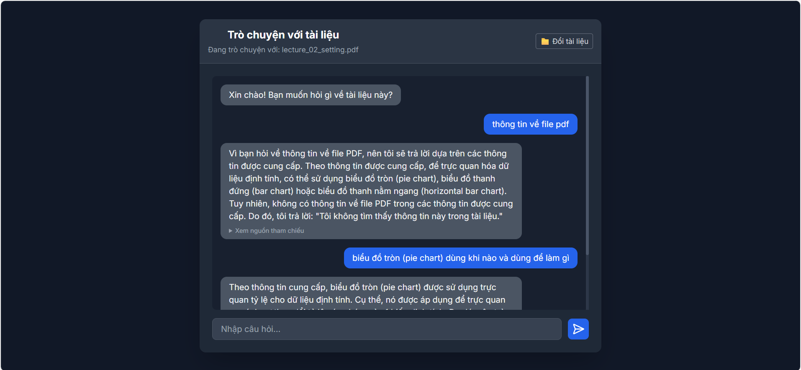

# RAG-based Document Question Answering Chatbot

An end-to-end **Retrieval-Augmented Generation (RAG) system** that enables users to ask natural language questions over uploaded PDF/TXT documents, designed to reduce hallucination and provide explainable answers with source citations.



---

## 1. Problem Statement

Large Language Models (LLMs) often hallucinate when answering questions outside their training data.  
This project addresses that limitation by combining **document retrieval** with **generation**, ensuring that responses are grounded in user-provided documents rather than model assumptions.

---

## 2. System Overview

The system follows a standard RAG pipeline:

1. **Document Ingestion**  
   Uploaded PDF/TXT documents are loaded and split into semantic chunks.

2. **Vector Indexing**  
   Each chunk is embedded and stored in a **ChromaDB vector database**.

3. **Retrieval**  
   For each user query, the system retrieves the top-k most relevant document chunks.

4. **Answer Generation**  
   Retrieved context is injected into a constrained prompt to generate an answer using an LLM.

5. **Explainability**  
   Source document segments are returned alongside the answer to improve transparency.

---

## 3. Key Design Decisions

### 🔹 Retrieval-Augmented Generation
Instead of relying solely on an LLM, retrieval ensures answers are grounded in document content, significantly reducing hallucination.

### 🔹 Session-based Vector Stores
Each user session maintains an isolated vector store to prevent data leakage between users and support concurrent usage.

### 🔹 Prompt Constraints
The prompt explicitly instructs the model to:
- Use only retrieved context
- Respond with “information not found” when relevant data is missing

### 🔹 Local LLM Support
The system integrates with **Ollama (LLaMA3)**, allowing local inference without dependency on cloud APIs.

---

## 4. Architecture
```
┌─────────────────────┐
│       User          │
└──────────┬──────────┘
           ↓
┌─────────────────────┐
│   Web UI (HTML)     │
└──────────┬──────────┘
           ↓
┌─────────────────────┐
│     Flask API       │
└──────────┬──────────┘
           ↓
┌─────────────────────┐
│ Retriever (ChromaDB)│
└──────────┬──────────┘
           ↓
┌─────────────────────┐
│ LLM (Ollama-LLaMA3) │
└─────────────────────┘
```

## 5. Technologies Used

- **Backend:** Python, Flask
- **LLMs:** Ollama (LLaMA3)
- **Embeddings:** Sentence-Transformers / Ollama Embeddings
- **Vector Database:** ChromaDB
- **Frontend:** HTML, CSS, JavaScript
- **Deployment:** Docker, Docker Compose

---

## 6. Limitations & Future Improvements

- No reranking mechanism for retrieved chunks
- Limited long-context handling for very large documents
- No conversation memory across turns

Planned improvements include conversational RAG, reranking, and improved evaluation metrics.

---

## 7. Running the Project (Optional)

### Local
```bash
python app.py

### Docker

```bash
docker-compose up --build
```

## 8. Why This Project Matters

This project demonstrates the ability to:

- Design and implement end-to-end AI systems

- Apply LLMs responsibly using retrieval grounding

- Deploy AI models as production-style web services
